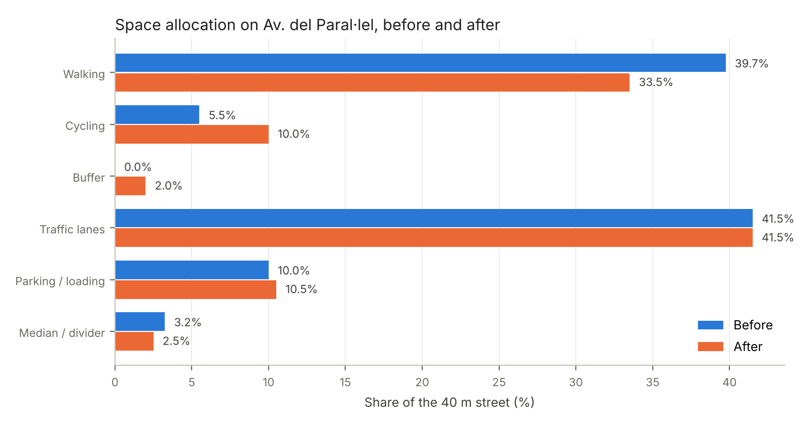
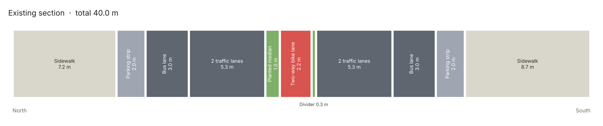
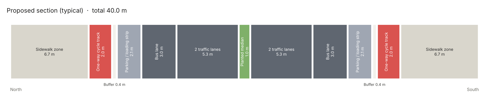
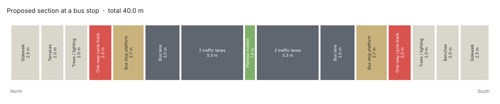
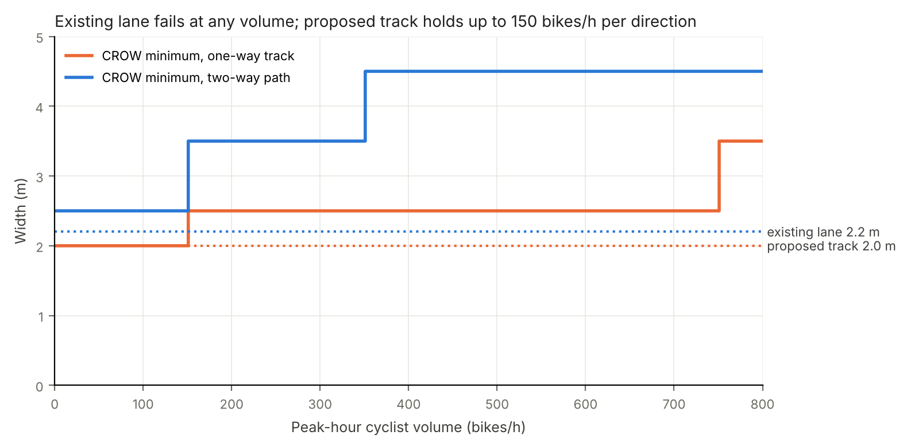

# Protected cycle tracks for Avinguda del Paral·lel, Barcelona

**Street redesign and before/after evaluation of cycling infrastructure on a 40 m urban avenue.**
Presented at Smart City Expo World Congress 2026, Barcelona, as the final project of PACE 1 – *Designing and Evaluating Active Mobility Systems* (UPC School / EIT Urban Mobility).



## In one minute
- **Problem:** the avenue's bike lane runs down the centre of the road – 2.2 m for both directions (1.1 m each), with moving traffic on both sides and no direct link to shops, side streets or the metro. Many cyclists ride at the kerb instead.
- **Proposal:** a 2.0 m one-way cycle track along each kerb, protected by a 0.4 m buffer and a 2.1 m parking/loading strip, with floating bus stops and a protected junction.
- **Result:** cycling width per direction **+82%**, cycling share of the street **5.5% → 10%**, **0** traffic lanes to cross to reach the kerb – with **no loss** of bus lanes, traffic lanes or parking.

## Before and after




## Evaluation
| Indicator | Category | Before | After |
|---|---|---|---|
| Cycling width per direction | Mobility | 1.1 m (two-way) | 2.0 m (one-way) |
| Meets CROW minimum width | Comfort | no | yes |
| Separation from moving traffic | Safety | divider + median, traffic on both sides | buffer + parking strip, traffic on one side |
| Traffic lanes crossed to reach the kerb | Access | 3 | 0 |
| Clear walking path | Urban quality | 2.7 m | 3.3 m |
| Share of the 40 m street for cycling | Space allocation | 5.5% | 10% (+2% buffer) |
| Traffic lanes and parking | Feasibility | – | unchanged |

**Trade-offs** are stated openly: the sidewalk zone narrows (7.2 / 8.7 m → 6.7 m), the 0.4 m door buffer is the Barcelona minimum, and bus passengers cross the track at floating stops.

### Is 2.0 m enough without cyclist counts?
No counts were available, so the width was tested against CROW guidance for every peak-hour volume from 0 to 800 bikes/h. The existing 2.2 m two-way lane is below CROW at any volume; the proposed 2.0 m one-way track meets it up to 150 bikes/h per direction – the threshold that a peak-hour count should verify.



## Alternatives
A multi-criteria comparison (safety, connectivity, comfort, urban quality, traffic impact, feasibility) against a widened central two-way lane favoured the kerbside tracks: they follow observed cycling behaviour, give physical separation on a 3-lane-per-direction road at 50 km/h, and match the solution recommended for main distributors with shops on both sides (CROW). Full reasoning, limitations and next steps are in the [report](docs/PACE1_Paralel_cycle_tracks_report.pdf).

## Method
1. **Select** – 365 m segment around the Ronda de Sant Pau junction, measured in GIS imagery (brief: 300–800 m).
2. **Diagnose** – site visit and photos; cross-section measured from satellite imagery and Street View, checked against a 40 m building-to-building total.
3. **Design** – cross-sections and junction layout checked against CROW (2016) and the Barcelona cycle-lane manual (2016).
4. **Evaluate** – indicators computed from the section data (`analysis/`).
5. **Justify** – multi-criteria comparison of alternatives, trade-offs and limitations.

## Run it
```bash
pip install -r requirements.txt
python analysis/cross_section.py     # scaled before/after cross-sections
python analysis/indicators.py        # indicator table -> results/indicators.md
python analysis/crow_width_check.py  # width vs. cyclist-volume sensitivity check
```
The same analysis is also available in **R** (ggplot2), giving identical results:
```bash
Rscript analysis/R/paralel_analysis.R   # writes figures/r/
```
All figures are generated from one data file, `data/cross_sections.csv`; each section is checked to add up to 40 m.

```
data/cross_sections.csv     widths per element and section (m)
analysis/                   Python: cross-section drawing, indicators, CROW width check
analysis/R/                 R version of the same analysis
results/indicators.md       generated indicator table
figures/                    generated figures
docs/                       project report (PDF)
```

## My role
Team project (5 people). I measured the existing cross-section, built the evaluation framework and all before/after indicators, wrote the multi-criteria justification, trade-offs and limitations, assembled the final presentation and wrote the project report. The analysis code and figures in this repository are my own work.

## Skills
Street design · Active mobility planning · Before/after evaluation · Multi-criteria analysis · CROW and Barcelona design guidance · Python (matplotlib) · R (ggplot2) · Data-driven reporting

## Next steps
Peak-hour cyclist counts, a CycleRAP forecast for the new layout, and a temporary tactical-urbanism trial with before/after monitoring against a control street.

## References
CROW (2016) *Design Manual for Bicycle Traffic* · Ajuntament de Barcelona (2016) *Manual de disseny de carrils bici* · Generalitat de Catalunya (2008) *Manual per al disseny de vies ciclistes de Catalunya* · GDCI (2016) *Global Street Design Guide* · NACTO (2017) *Designing for All Ages & Abilities* · Geller (2006) *Four Types of Cyclists*.

*Code: MIT licence. Widths are approximate and come from imagery, not a measured survey.*
